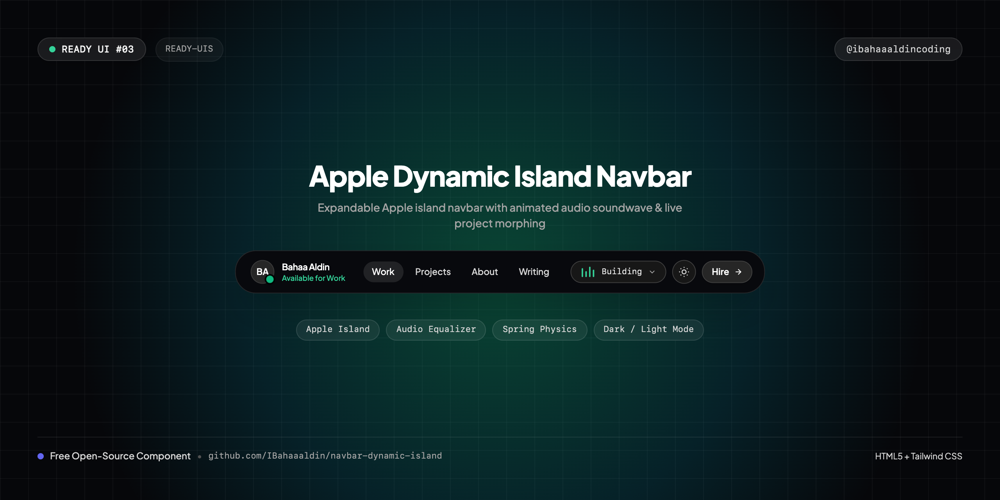
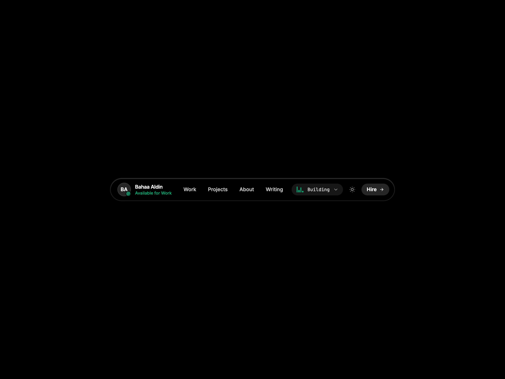
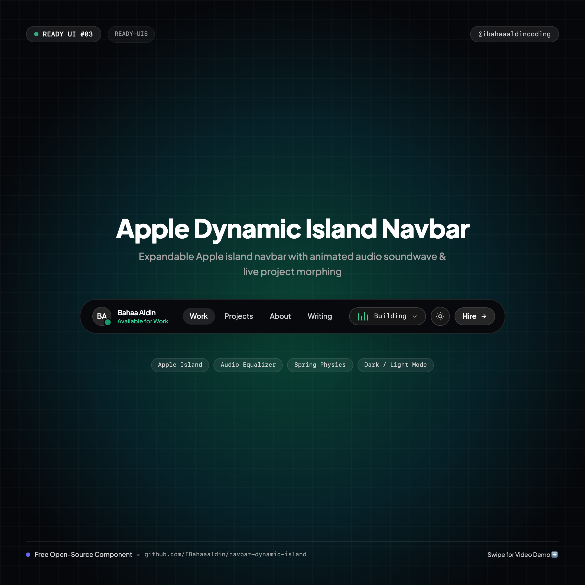

# 🏝️ Dynamic Island Navbar

> An interactive, fluid Dynamic Island navbar inspired by iOS hardware design with live development activity waveform, spring physics expansion, and dark/light mode.



[](https://IBahaaaldin.github.io/navbar-dynamic-island/)
[](https://IBahaaaldin.github.io/navbar-dynamic-island/)

---

## 🌐 Visual Previews

| Desktop Showcase (1200x900) | Mobile Showcase (390x844) | Instagram Cover (1080x1080) |
| :---: | :---: | :---: |
|  |  |  |

*(Includes full interaction videos: `video-desktop.mp4` and `video-mobile.mp4`)*

---

## ✨ Features & Micro-Interactions

- **Apple Dynamic Island Physics**: Starts as a compact resting pill and springs open smoothly with Apple-style cubic-bezier timing (`cubic-bezier(0.175, 0.885, 0.32, 1.15)`).
- **Live Activity Waveform**: Animated equalizer bars displaying live development status (`Building: Air Canvas ⚡`).
- **Interactive Morphing Expansion**: Expanding reveals live project repo card, mobile navigation rows, social links, and direct contact CTA.
- **Top-Anchored Ergonomics**: Anchored gracefully at `top-4` on mobile and `top-6` on desktop. Never jumps into awkward screen positions when resizing.
- **Strict Single-Line Text**: Names and descriptions strictly kept on single rows with zero wrapping.
- **Fluid Dark / Light Theme Switcher**: Sun ☀️ / Moon 🌙 button built directly into the island that flips the canvas between pure black (`#000000`) and pure white (`#ffffff`).
- **Zero Build Step**: 100% self-contained HTML5 + Tailwind CSS CDN + inline SVGs.

---

## 📁 Repository Structure

```text
├── index.html              # Standalone production navbar component
├── cover.png               # Widescreen cover banner (1280x640)
├── cover-instagram.png     # Square cover for Instagram (@ibahaaaldincoding) (1080x1080)
├── screenshot-desktop.png  # Desktop visual preview (1200x900)
├── video-desktop.mp4       # Desktop interaction recording (MP4)
├── screenshot-mobile.png   # Mobile visual preview (390x844)
├── video-mobile.mp4        # Mobile interaction recording (MP4)
├── record.js               # Playwright automation script used to record all 4 assets
├── README.md               # Documentation & setup notes
└── CAPTION.md              # Ready-to-copy Instagram caption for @ibahaaaldincoding
```

---

## 🚀 Quick Start

### 1. View Locally
Simply open `index.html` in your browser:
```bash
open index.html
```

### 2. Interaction
Click anywhere on the Dynamic Island pill to morph between compact and expanded states.

---

## 📬 Connect

- **Instagram**: [@ibahaaaldincoding](https://www.instagram.com/ibahaaaldincoding)
- **GitHub**: [@IBahaaaldin](https://github.com/IBahaaaldin)
- **LinkedIn**: [Bahaa Mohammed](https://www.linkedin.com/in/bahaa-mohammed-371259369)
- **Email**: bahaam.coding@gmail.com
